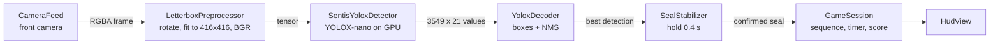

# HandSealAI

A camera game for Android written in C# with Unity: make hand seals in front of the phone's front camera,
the app recognises them in real time with a neural network, and the right sequence completes a technique.

Everything runs on the device. No server, no account, no network.

## Status

Version 0.3:

- live recognition of 12 zodiac hand seals (plus two extra gestures) with a YOLOX-nano model running on Unity Sentis
- a seal counts only after it is held for 0.4 s; short dropouts and one-frame misreads do not interrupt the hold
- main menu with a training mode and a list of techniques
- **training**: the game names a random seal, you make it, the next one follows; it counts correct answers,
  mistakes and your fastest answer, and tells you which seal it saw when you got it wrong
- **techniques**: five sequences against the clock with progress, score, combo and locally saved best times;
  play one on repeat or all of them in a row
- **settings**: confidence needed, hold time, sound, GPU or CPU, and a debug view of the model input;
  saved on the phone
- **feedback**: sounds for right and wrong seals, the countdown and the result, sparks and a screen flash
  when a technique is completed; all sounds are synthesised in code, so the project ships no audio files
- **hints** when nothing has been recognised for 3 seconds: show your hands, or hold the seal steadier
- if the GPU backend fails on a phone, recognition switches to the CPU by itself
- game rules, model pre/post-processing, settings and sound synthesis in a Unity-free C# library
  covered by 147 unit tests

Not there yet: reference cards with photos of the seals. See [Roadmap](#roadmap).

## How it works



| Assembly | Depends on | What is inside |
| --- | --- | --- |
| `HandSeals.Core` | nothing (no Unity references) | seals, frame preprocessing, YOLOX decoding, stabilizer, techniques, game session, training session, scoring, progress |
| `HandSeals.Recognition` | Core, Sentis | `SentisYoloxDetector`: runs the model and returns detections |
| `HandSeals.Game` | Core, Recognition, uGUI | camera, recognition loop, game modes, menu and HUD, JSON data |
| `HandSeals.Editor` | Game | creates the main scene and applies player settings |

Camera frames go to the model only when the previous inference has finished, so the preview stays smooth
however fast or slow the phone is. In the menu the model is paused to save battery.

## Getting started

Requirements: **Unity 6** (6000.0 LTS or newer) with the **Android Build Support** module.

1. Clone the repository and add the folder in Unity Hub. If Hub says the exact editor version is missing,
   pick the Unity 6 version you have installed.
2. On the first import Unity downloads the packages (Sentis is `com.unity.ai.inference`), and an editor script
   creates `Assets/_Project/Scenes/Main.unity` and applies the player settings (portrait, IL2CPP, ARM64).
   If the scene did not appear, use the menu **HandSealAI > Create main scene**.
3. Press **Play**. In the editor the game uses your webcam.
4. For the phone: **File > Build Profiles > Android > Switch Platform**, connect the phone with USB debugging
   enabled and choose **Build And Run**.
5. Commit what Unity generated on the first import (`.meta` files, the scene, `ProjectSettings/`), so the
   project opens identically on another machine.

Playing: pick a mode in the menu, stand the phone upright against something and step back until your hands
and chest are in the picture. The top of the screen shows what to do, the bottom shows what the model sees
and how long you still have to hold the seal. Good, even light helps a lot. The **Menu** button or the
Android back button returns to the menu.

Buttons work with either input backend: the built-in Input Manager, or the Input System package if the
project is switched to it.

## Tuning

Players change these on the **Settings** screen in the menu; they are saved in `progress.json` in the
app's data folder:

| Setting | Default | Range | Meaning |
| --- | --- | --- | --- |
| Confidence needed | 60% | 30–90% | a seal must reach this score to start the hold timer |
| Hold time | 0.4 s | 0.2–1.0 s | how long a seal must be held to count |
| Sound | on | | effects for right and wrong seals |
| Run the model on the GPU | on | | off = CPU; try it if recognition looks wrong on a phone |
| Show model input | off | | the 416 x 416 image exactly as the model receives it |

Developer defaults are on the `AppRoot` component of the **App** object: camera resolution, the decoder's
score threshold (0.3) and the countdown (3 s).

If recognition is poor on a particular phone, turn on **Show model input** first: the picture in the corner
must be upright and not mirrored. The status line at the bottom shows the backend, inference time,
camera resolution and rotation.

## Techniques

Techniques live in `Assets/_Project/Resources/Data/jutsu.json`; adding one needs no code:

```json
{
  "id": "ember-spark",
  "name": "Ember Spark",
  "seals": ["Ox", "Tiger", "Bird"],
  "timeLimitSeconds": 10,
  "baseScore": 100
}
```

Seal names: Rat, Ox, Tiger, Hare, Dragon, Snake, Horse, Ram, Monkey, Bird, Dog, Boar, Gassho, Mizunoe.

Score for a completed technique = base score x time bonus (1 to 2) x combo multiplier (1 to 2).

## Tests

The core has no Unity dependency, so its tests run in two ways from the same source files:

- in Unity: **Window > General > Test Runner > EditMode**
- without Unity: `dotnet test dotnet/HandSealAI.Core.sln` (also runs in GitHub Actions on every push)

The C# port of the model's pre- and post-processing was checked against the model author's Python
implementation on real photos: identical detections, input tensors within one grey level.

## Roadmap

- reference cards with photos of every seal, shown in the training mode
- recording frames on the device to fine-tune the model on more hands and lighting
- web leaderboard with an ASP.NET Core API

## Credits

The hand-sign model is by Kazuhito Takahashi:
[Kazuhito00/NARUTO-HandSignDetection](https://github.com/Kazuhito00/NARUTO-HandSignDetection), MIT License.
See [THIRD_PARTY_NOTICES.md](THIRD_PARTY_NOTICES.md).
